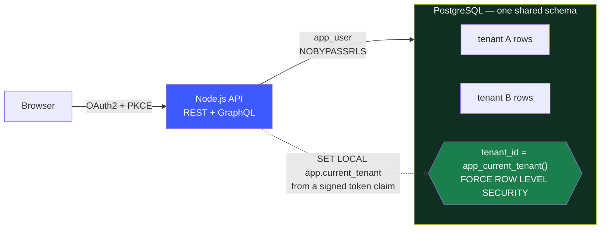

# sw-saas-platform

A multi-tenant SaaS platform where **the database refuses to leak data, not the
application code**.



Every customer's rows live in the same tables. A request can only ever see its own,
because the tenant it is scoped to is a **signed claim installed into the transaction**,
and the application connects as a role that **cannot switch row-level security off**.

Forget the `WHERE tenant_id = ...` clause and you get zero rows, not somebody else's data.
[There is a test for exactly that.](apps/api/tests/isolation/rls-reads.test.ts)

---

## Run it

One command. No AWS account, no external identity provider, no configuration.

```bash
docker compose up --build
```

| | |
|---|---|
| Web | <http://localhost:3000> |
| API | <http://localhost:4000> |
| GraphQL | <http://localhost:4000/graphql> |
| Dev identity provider | <http://localhost:4010> |
| Prometheus | <http://localhost:9090> |
| Grafana | <http://localhost:3001> |

Sign in as any demo user — no passwords, it runs a real OAuth2 authorization-code + PKCE
flow against a real (if credulous) OIDC provider bundled in the repo.

| User | Why |
|---|---|
| `alice@acme.test` | Owner of Acme Corp |
| `carol@globex.test` | Owner of Globex — a completely separate tenant |
| `dave@globex.test` | Belongs to **both** — use this to try tenant switching |
| `erin@newco.test` | Belongs to nothing — logging in provisions a fresh tenant |

Then try the interesting part: copy a project id from Acme, switch to Globex, and paste it
into the URL. You get a 404 — not a 403, because a 403 would confirm the resource exists.

---

## The claim, and the evidence

> Tenant isolation is enforced below the application, so an application bug cannot leak
> another customer's data.

Claims like that are cheap. Here is what backs it up.

```bash
npm run test:isolation        # 68 tests that attack the boundary
node scripts/verify-isolation.mjs   # proves those tests would catch a missing policy
node scripts/smoke-test.mjs   # 28 end-to-end checks against the running stack
```

**68 isolation tests**, run against real PostgreSQL — not a mock, because a mock would only
assert that I mocked row-level security correctly. They play a legitimately authenticated
user of tenant A who has learned tenant B's primary keys, which is the realistic threat
model for multi-tenant software.

| | |
|---|---|
| Reads scoped to A never return B's rows | ✅ |
| A query that **forgets its `WHERE` clause entirely** still returns only A's rows | ✅ |
| A connection with no tenant set sees **zero** rows (fail closed) | ✅ |
| `INSERT` cannot forge a foreign `tenant_id`; `UPDATE` cannot move a row between tenants | ✅ |
| `UPDATE`/`DELETE` on a known foreign id affect **0 rows** | ✅ |
| Foreign rows unreachable by pivoting through a join | ✅ |
| Aggregates do not leak the existence of foreign rows | ✅ |
| Tenant context does not survive its transaction (pool-recycling regression) | ✅ |
| Tampered, forged and unsigned tokens rejected | ✅ |
| `X-Tenant-Id` header injection ignored | ✅ |
| Cross-tenant reads through **nested GraphQL resolvers** | ✅ |
| Cross-tenant cache poisoning via Redis | ✅ |
| The app role cannot `SET ROLE`, disable RLS, or drop a policy | ✅ |

**And the tests are themselves tested.** `scripts/verify-isolation.mjs` disables row-level
security on each tenant-owned table in turn, re-runs the suite, and asserts it goes **red**:

```
  RLS disabled on memberships  ... detected (2 test(s) failed)
  RLS disabled on projects     ... detected (7 test(s) failed)
  RLS disabled on tasks        ... detected (9 test(s) failed)
  RLS disabled on comments     ... detected (5 test(s) failed)
  RLS disabled on audit_log    ... detected (3 test(s) failed)

  All 5 tenant-owned tables are covered by a test that fails when their policy is removed.
```

A passing suite proves nothing on its own — it might pass because the assertions are
vacuous. This is the check that makes it mean something, and it runs in CI.

---

## Kubernetes, locally

The Kubernetes layer is not only rendered; CI runs it. The `kind` job creates a kind
cluster with the default CNI replaced by Calico, so NetworkPolicies are enforced, and
deploys the **dev overlay** with images built from the commit:

```bash
scripts/kind/up.sh              # cluster, Calico, data stores, LocalStack, External Secrets, dev overlay
scripts/kind/netpol-check.sh    # NetworkPolicy allow and deny checks
scripts/kind/isolation-tests.sh # the 68 isolation tests against the in-cluster API
scripts/kind/up.sh --down
```

| AWS piece | Stand-in on kind |
|---|---|
| EKS with an enforcing CNI | kind v0.33.0, node v1.35.8, Calico v3.32.3 |
| RDS for PostgreSQL, ElastiCache | `postgres:16.4-alpine` and `redis:7.4-alpine` in a `data` namespace, inside the 10.0.0.0/8 range the policies allow |
| Secrets Manager | LocalStack 4.14.0 (Community, pinned by digest) |
| External Secrets with IRSA | External Secrets Operator 2.14.0 (Helm), the base `ExternalSecret` unchanged; only the `SecretStore` auth is swapped from IRSA to static LocalStack keys (`infra/k8s/overlays/kind`) |

The NetworkPolicy check connects to Postgres and Redis from inside pods: the API pod must
connect, the web pod and an unlabelled pod in `saas` must not, and the same unlabelled pod
in a namespace without policies must connect, which shows the denials are the policy and
not the network. Running the overlay this way found a real bug: default-deny also blocked
the migration Job, which had no policy of its own and could never have reached the
database. It now has one.

All versions are pinned in [`infra/k8s/kind/versions.env`](infra/k8s/kind/versions.env).

## Load test

```bash
RUNNER_LABEL="describe this machine" loadtest/run.sh   # or: Actions > Load test > Run workflow
```

A basic [k6](loadtest/k6/api.js) test (grafana/k6 1.8.2) against the API in docker compose,
run as `NODE_ENV=production`: each iteration is `GET /v1/projects`, `GET /v1/tasks` and a
nested GraphQL query as one tenant. It is a manual workflow, because a shared CI runner
measures the runner as much as the code. Results are committed only with the machine they
came from: see [`loadtest/results/`](loadtest/results/).

---

## How the isolation actually works

The full argument, including the models rejected and why, is in
**[docs/multi_tenancy.md](docs/multi_tenancy.md)**. In short:

**Pool tenancy** — shared database, shared schema, `tenant_id` on every row. Chosen for
cost and operational simplicity: silo would mean an RDS instance per customer, roughly $50
per tenant per month.

Pool's weakness is real and unhedged: **one missing `WHERE` clause leaks data** — if the
application is the only guard. So it isn't.

```sql
CREATE POLICY tenant_isolation ON tasks
    USING      (tenant_id = app_current_tenant())
    WITH CHECK (tenant_id = app_current_tenant());
```

Three things hold it up, each independently verified by a test:

1. **`ENABLE` + `FORCE` row level security** on every tenant-owned table. `FORCE` matters:
   without it the table *owner* is exempt, and running as the owner is an easy, silent
   mistake.
2. **The app connects as `app_user`** — `NOSUPERUSER`, `NOBYPASSRLS`, owns nothing.
   Superusers ignore policies entirely, so this is load-bearing. The API **refuses to
   boot** if its own role can bypass RLS.
3. **Tenant identity arrives per-transaction** via `SET LOCAL`, through one chokepoint.
   Unset ⇒ `NULL` ⇒ nothing matches. Fail closed.

`SET LOCAL` rather than `SET` is not a detail: plain `SET` persists on a pooled connection
and would be inherited by the next request, which may belong to a different tenant — an
intermittent, concurrency-dependent leak that passes every serial test.

There is exactly one way for business logic to reach the database:

```ts
await withTenant(auth.tenantId, async (tx) => {
  // BEGIN; SET LOCAL app.current_tenant = $1;  ...  COMMIT
  // No release(), no raw pool, no way out.
});
```

And the schema makes cross-tenant references *unrepresentable*, independently of RLS:

```sql
CONSTRAINT tasks_project_fk FOREIGN KEY (tenant_id, project_id)
    REFERENCES projects (tenant_id, id)
```

---

## What is here

```
apps/
  api/          Fastify, REST + GraphQL over one tenant-scoped service layer
  web/          Next.js 15, typed against the same shared contract
  dev-idp/      A real OIDC provider so OAuth2 runs offline (authenticates nobody)
packages/
  shared-types/ One source of truth for the wire format
infra/
  terraform/    VPC, EKS, RDS, ElastiCache — modules + dev/prod environments
  k8s/          Kustomize base and overlays (dev, prod, and kind for local runs)
observability/  Prometheus config, alert rules, Grafana dashboard
docs/           The reasoning
scripts/        setup, demo, isolation mutation check, smoke test, cost estimate,
               kind/ (local Kubernetes run, NetworkPolicy checks)
loadtest/      k6 load test, its compose override and labelled results
```

**Stack:** TypeScript · Next.js 15 · Fastify 5 · PostgreSQL 16 · Redis 7 · GraphQL Yoga ·
OAuth2/OIDC · Docker · Kubernetes on EKS · Terraform · GitHub Actions · Prometheus ·
Grafana

---

## Documentation

| | |
|---|---|
| **[Multi-tenancy model](docs/multi_tenancy.md)** | The decision everything follows from. Read this one. |
| [Architecture](docs/architecture.md) | Components, request path, decisions defended |
| [Data model / ERD](docs/erd.md) | Schema, composite foreign keys, indexes |
| [Auth flow](docs/auth_flow.md) | OAuth2 + PKCE, token design, refresh rotation |
| [SLOs](docs/slos.md) | Three objectives, error budgets, burn-rate alerting |
| [Runbook](docs/runbook.md) | Incident procedures, including suspected data exposure |
| **[Cost](docs/cost.md)** | **$175/month dev, $509/month prod, $0 local** |
| **[Teardown](docs/teardown.md)** | **How to stop paying — including what Terraform leaves behind** |

---

## Cost

**Running the demo locally is free.** Everything the project is actually about — the
isolation model, the attack tests, the auth flow — is demonstrated by
`docker compose up` for nothing.

The AWS environments are not free, and **70% of the dev bill is fixed cost that scaling to
zero does not reduce** (EKS control plane $73/mo, NAT gateway $33/mo, ALB $16/mo).

| | Monthly | Per hour |
|---|---:|---:|
| Local | **$0.00** | $0.00 |
| Dev on AWS | $174.78 | $0.24 |
| Production on AWS | $509.13 | $0.70 |

```bash
node scripts/estimate-cost.mjs    # every figure above, itemised
```

If you do apply it: **[read the teardown guide](docs/teardown.md) first.**
`terraform destroy` alone does not empty the account — load balancers created by the
Kubernetes controller, final RDS snapshots and Secrets Manager entries all survive it and
keep billing.

---

## Honest status

Nothing here is a stub presented as working.

| | |
|---|---|
| Local stack (`docker compose up`) | ✅ **Runs.** Verified end to end — 28 smoke checks including a real OAuth2 flow |
| Isolation tests | ✅ **68 passing** against real PostgreSQL, and mutation-checked. The same 68 also pass against the API deployed in kind |
| Kustomize overlays | ✅ **Deployed on kind in CI.** The dev overlay runs on a kind cluster with Calico: secrets synced, migration Job complete, API and web ready. Dev and prod both build (21 resources each) |
| Terraform | ⚠️ **Written, never applied.** No AWS account has run it |
| Production environment | ⚠️ **Written, never deployed** |
| Deploy workflows | ⚠️ **Manual only, never run.** Both start from `workflow_dispatch`; no AWS account or deploy secrets are connected |
| SLOs | ⚠️ **Defined and instrumented, not operated** — no production traffic, no on-call |
| Silo tenancy path | ⚠️ **Schema-supported, not exercised** |
| NetworkPolicies | ✅ **Enforcement proven on kind with Calico** (6 allow and deny checks in CI). Not verified on EKS, where the VPC CNI does not enforce them by default |
| External Secrets | ✅ **Exercised against an emulator.** The External Secrets Operator syncs the app secret from LocalStack Secrets Manager; IRSA to real AWS is not exercised |
| Load testing | ⚠️ **Basic k6 test, manual workflow.** One labelled result from a GitHub-hosted runner in [`loadtest/results/`](loadtest/results/); nothing at production scale |

The gap between "the local stack works and is tested" and "the cloud infrastructure works"
is real. The first is one command away; the second is reviewed, type-checked code that has
never met AWS, because applying it costs $175/month and the architecture is the point.

### Limitations

- **Noisy neighbours are only partly addressed.** Per-tenant rate limiting at the edge, no
  query-level governance. This is the honest argument for silo at enterprise tier.
- **No per-tenant restore.** Shared tables mean recovering one customer is a full-cluster
  point-in-time restore plus manual extraction. Procedure in the runbook; not automated.
- **Access tokens cannot be revoked before expiry.** 15 minutes is the exposure window.
- **No distributed tracing.** Request ids correlate logs; there are no spans.
- **Migrations are forward-only.** Deliberate, but a bad one means a restore or a new
  forward migration.
- **`tenants` and `users` are not RLS-protected** — read by primary key from verified
  claims, but they are where the database is not the backstop. [Justified here](docs/multi_tenancy.md#4-what-is-not-tenant-scoped).

---

## Development

```bash
./scripts/setup.sh      # deps, .env, Postgres + Redis, migrate, seed
npm run dev:api         # http://localhost:4000
npm run dev:web         # http://localhost:3000

npm test                # everything
npm run test:isolation  # just the cross-tenant attacks
make help               # all targets
```

Requires Node 22+ and Docker. `make` is optional — every target wraps a command you can
run by hand.

### Data

All data is synthetic, generated by [`apps/api/src/db/seed.ts`](apps/api/src/db/seed.ts).
No external datasets are used, so there are no dataset licences to record.

---

## Licence

[MIT](LICENSE).
