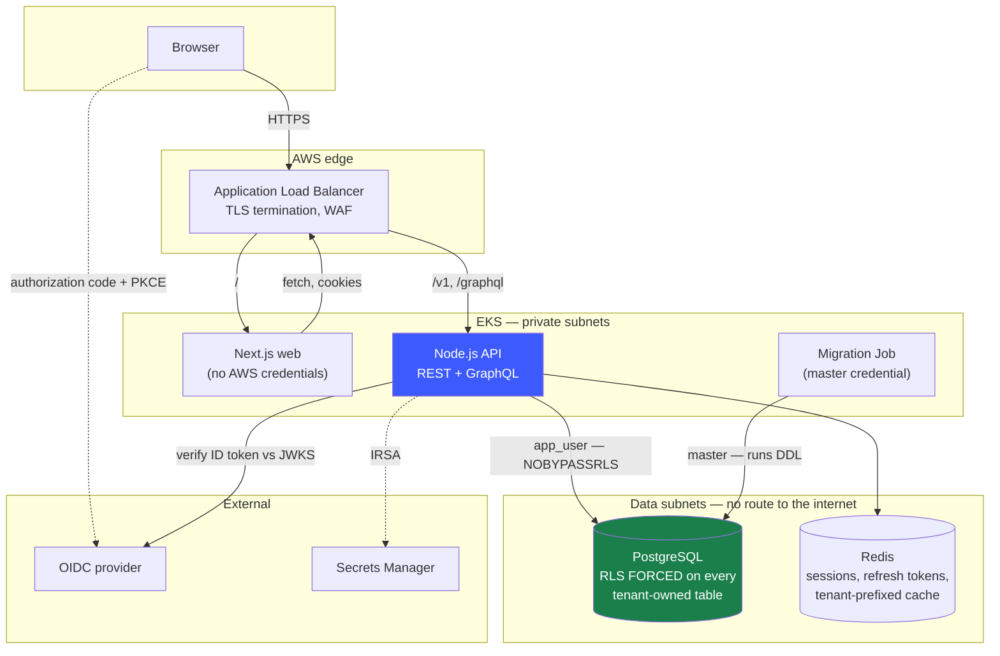
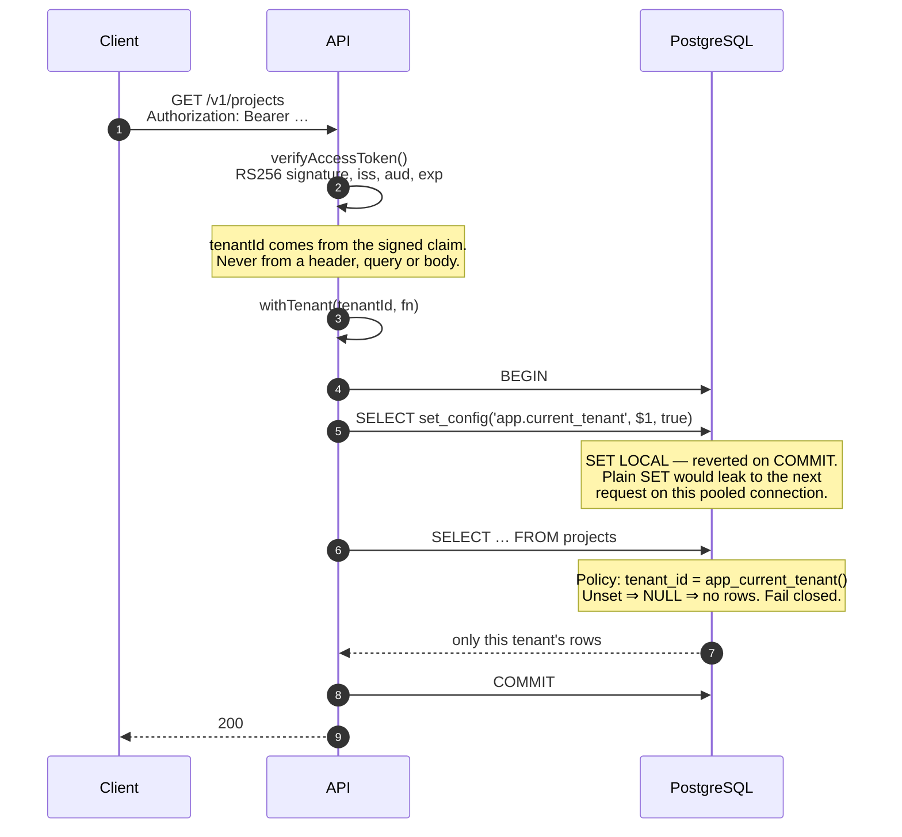

# Architecture

## The one-sentence version

A pooled multi-tenant application where every customer's rows share the same tables, and
isolation is enforced by PostgreSQL row-level security under a database role that cannot
switch it off — so a missing `WHERE` clause returns nothing instead of someone else's data.

Everything below follows from that decision. The reasoning behind it, including the
alternatives rejected, is in [multi_tenancy.md](multi_tenancy.md).

---

## System

Two things are load-bearing in that picture:

**The API and the migration Job reach Postgres with different credentials.** The API uses
`app_user`, which is `NOSUPERUSER`, `NOBYPASSRLS` and owns nothing. Migrations use the
master user, which can create roles and alter policies. That separation is why a
compromised API pod cannot rewrite its own isolation policies — and the API asserts at
boot that its own role cannot bypass RLS, so a deployment that "fixed a permissions error"
by pointing at the master credential fails to start rather than silently serving with
isolation disabled.

**The web tier has no AWS credentials and no database access.** Its service account has
`automountServiceAccountToken: false` and no IRSA annotation. A NetworkPolicy permits it
to reach the API and nothing else.

---

## Request path

Every read pays for a transaction it would not otherwise need, because `SET LOCAL`
requires one. Measured at roughly 0.3 ms locally. That is the price of making the safe
path the only path.

---

## Layers of isolation

If any single row fails, the row beneath it still denies the request.

| Layer | Mechanism | Fails closed? |
|---|---|---|
| Token | `tenantId` is an RS256-signed claim | Yes — unsigned or expired is rejected before routing |
| Request | `requireAuth` populates `req.auth` from the verified claim only | Yes — no claim, no tenant, 401 |
| Service | Every query goes through `withTenant()`; no raw pool access | Yes — no tenant, no connection |
| Query | Service layer also writes `WHERE tenant_id = $1` | **Partially — this is the layer assumed to be fallible** |
| **Database** | **RLS `FORCE` + `NOBYPASSRLS` role + `SET LOCAL`** | **Yes — unset variable matches nothing** |
| Schema | Composite FKs `(tenant_id, parent_id)` | Yes — cross-tenant references are unrepresentable |
| Cache | Keys built only by `tenantKey(tenantId, …)` | Yes — the builder requires a tenant id |
| Network | Data subnets have no route to a NAT | Yes — no egress path exists |

The row that matters is the one marked *partially*. The explicit `WHERE` clauses are there
for the query planner, not for correctness — [the isolation tests prove the system holds
without them](multi_tenancy.md#6-how-this-is-proved).

---

## Components

### `apps/api` — Node.js, Fastify, TypeScript

REST and GraphQL over **one** tenant-scoped service layer. Two implementations of the same
authorisation rules is how one of them ends up weaker; the GraphQL resolvers call the same
functions the REST handlers do.

| Path | Responsibility |
|---|---|
| `db/tenant-context.ts` | The chokepoint. The only way business logic gets a connection. |
| `db/migrations/` | Forward-only SQL. `0002_rls.sql` is the isolation boundary. |
| `auth/` | OIDC relying party, RS256 token issuance, refresh rotation with reuse detection |
| `services/` | Domain logic. Every function takes `tenantId` first. |
| `routes/`, `graphql/` | Two front doors, one service layer |
| `observability/` | Prometheus metrics — deliberately never labelled by tenant id |

### `apps/web` — Next.js 15, App Router

Typed against `@saas/shared-types`, the same package the API validates with, so a contract
change is a compile error rather than a runtime surprise.

The access token lives in an httpOnly cookie and is never read by JavaScript, so session
state comes from asking `/v1/auth/session` rather than decoding a token client-side. That
is also the more honest answer — a token is a snapshot from up to 15 minutes ago, and
membership may have been revoked since.

### `apps/dev-idp` — development OIDC provider

A real provider: discovery, JWKS, authorization code with PKCE (S256), single-use codes,
constant-time client secret comparison. It exists so the OAuth2 path is genuinely executed
offline instead of being stubbed until it reaches production. **It authenticates nobody**
— you pick a demo user from a list — and it is not deployed anywhere.

Pointing `OIDC_*` at Auth0, Google or Keycloak needs no code change, which is the property
that makes the shortcut acceptable.

---

## Decisions worth defending

**Pool tenancy with database-enforced isolation.** Cost and operational simplicity, with
the weakness (one missing `WHERE` leaks data) closed by moving enforcement below the
application. [Full reasoning](multi_tenancy.md#1-the-choice).

**Hand-written SQL and a hand-written migration runner, no ORM.** The RLS policies are the
security boundary and need to be auditable. An ORM would obscure exactly the thing under
review — whether the session variable is really set, in the right transaction, every time.
A runner you can read in one sitting is part of that argument.

**Resource ids are bare UUIDs, not `/v1/tenants/:tid/projects/:id`.** A tenant-in-path
design puts an attacker-controlled tenant id in front of every query, and correctness then
depends on remembering to compare it against the token on every single route. Here, tenant
is not part of the addressable surface at all.

**404 for cross-tenant access, never 403.** A 403 confirms the resource exists, which lets
one customer probe another's id space. From inside this tenant's view of the database the
row genuinely does not exist — RLS removed it before the handler ran.

**Per-loader transactions in GraphQL rather than one per operation.** Costs a
`BEGIN`/`COMMIT` per DataLoader batch and gives up read-consistency across resolver
levels. It buys keeping `withTenant` as the only route to a connection, rather than adding
a second lifecycle primitive that begins and commits outside the callback. Every escape
hatch is somewhere isolation can be got wrong later. Documented at
[`graphql/context.ts`](../apps/api/src/graphql/context.ts).

**No CPU limits on containers, memory limits only.** A CPU limit throttles the container
even when the node has spare capacity, showing up as unexplained p99 latency. Requests
govern scheduling and fair share. Memory is limited because it is not compressible and an
unbounded pod takes the node with it.

**Metrics are never labelled by tenant id.** Unbounded cardinality is the standard way to
melt a Prometheus server. Per-tenant numbers go in logs — every line carries `tenantId` —
and in the database.

---

## What is honest about the current state

No stub is presented as working, so:

| | Status |
|---|---|
| Local stack, `docker compose up` | **Runs.** Verified end to end by `scripts/smoke-test.mjs` — 28 checks including a real OAuth2 flow and cross-tenant attacks over HTTP and GraphQL |
| Isolation tests | **68 passing** against real PostgreSQL, and mutation-checked: `scripts/verify-isolation.mjs` proves they go red when a policy is removed. CI also runs them against the API deployed in kind |
| Kustomize overlays | **Deployed on kind in CI.** The dev overlay runs on kind with Calico (`scripts/kind/up.sh`); dev and prod both build, 21 resources each |
| Terraform | **Written, never applied.** No AWS account has run this. `terraform validate` runs in CI; nothing here has been proven against real AWS behaviour |
| Production environment | **Written, never deployed.** It is reviewable as code, not running somewhere |
| Deploy workflows | **Manual only, never exercised.** `deploy-staging.yml` and `deploy-prod.yml` run only from `workflow_dispatch`. No AWS account or deploy role secrets are connected, so neither has run |
| SLOs | **Defined and instrumented, not operated.** Alert rules parse and fire locally; there is no production traffic to measure and no on-call rotation |
| Silo tenancy path | **Schema-supported, not exercised.** `shard_dsn` is null for every tenant |
| NetworkPolicies | **Enforcement proven on kind with Calico** (`scripts/kind/netpol-check.sh`). Not verified on EKS, where the AWS VPC CNI does not enforce them by default |
| External Secrets | **Exercised against LocalStack Secrets Manager** on kind. IRSA authentication to real AWS is not exercised |

The gap between "the local stack works and is tested" and "the AWS infrastructure works"
is real and is not papered over. The first is demonstrable in one command; the second is
code that has been type-checked and reviewed but never applied, because applying it costs
[$175/month](cost.md) and the architecture is the point rather than the running instance.

---

## Known limitations

Beyond the [tenancy-specific ones](multi_tenancy.md#8-known-limitations):

- **Noisy neighbours are only partly addressed.** Per-tenant rate limiting exists at the
  edge; there is no query-level resource governance, and pool means no physical bulkhead.
  This is the strongest honest argument for silo at enterprise tier.
- **No distributed tracing.** Request ids correlate logs across services, but there are no
  spans. OpenTelemetry is the obvious next step and is not here.
- **Migrations are forward-only with no automated rollback.** Deliberate — reversible
  migration machinery mostly provides false comfort about operations nobody rehearses —
  but it means a bad migration is a restore or a new forward migration. The deploy
  workflow says so explicitly when it rolls back.
- **Secrets do not trigger a rollout.** External Secrets refreshes the Kubernetes Secret,
  but the API reads config at boot, so a rotated credential needs a restart. Noted in the
  runbook rather than hidden behind a reloader sidecar.
- **The `tenants` and `users` tables rely on application discipline, not RLS.** They are
  read by primary key with ids from verified claims, but they are where the database is
  not the backstop.
- **Load has never been tested.** The 0.3 ms transaction overhead is measured on one dev
  machine. Nothing here has seen concurrent traffic at scale.
