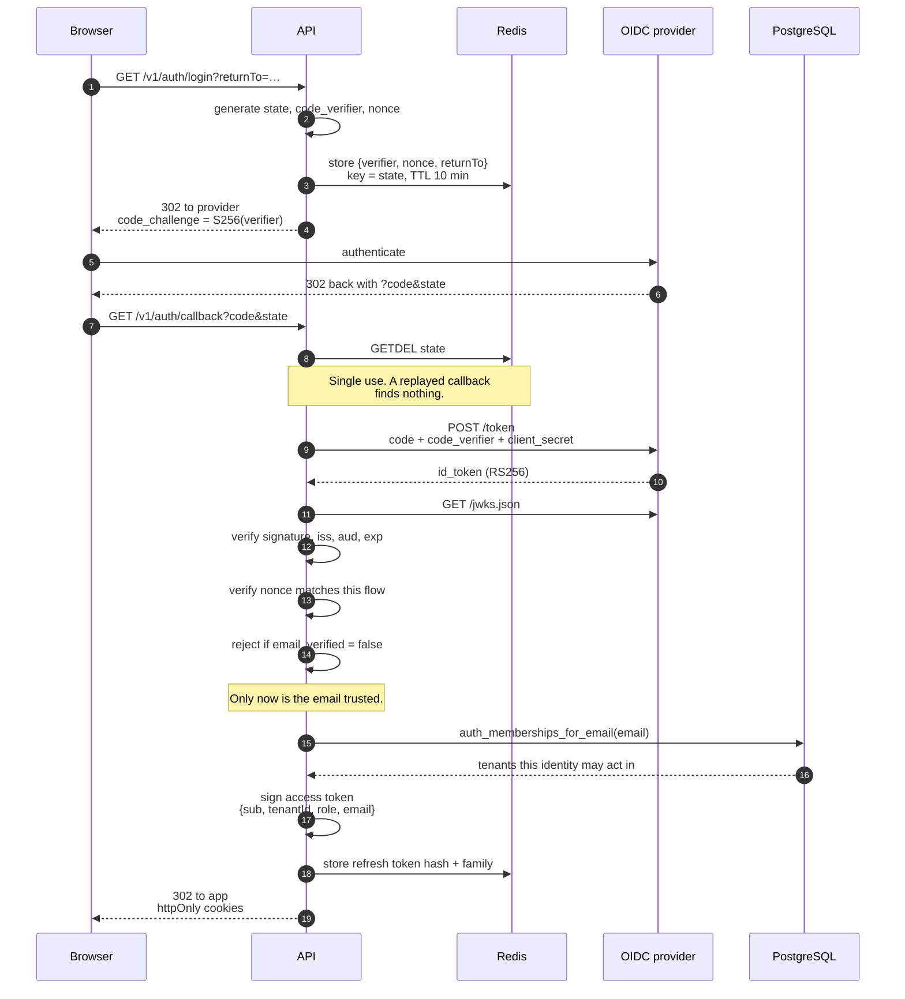
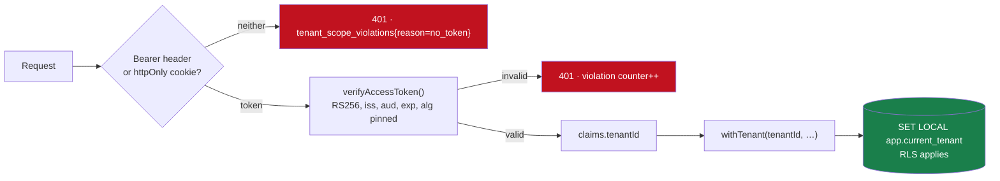
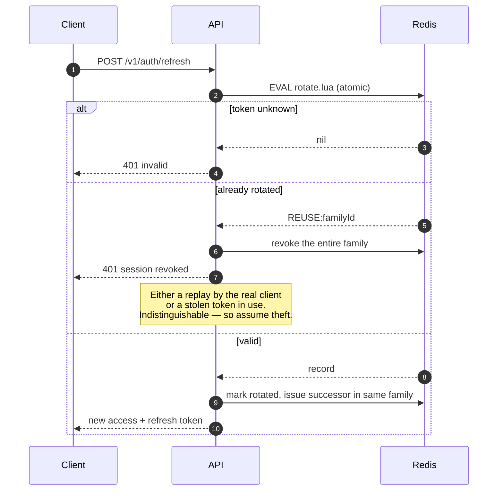
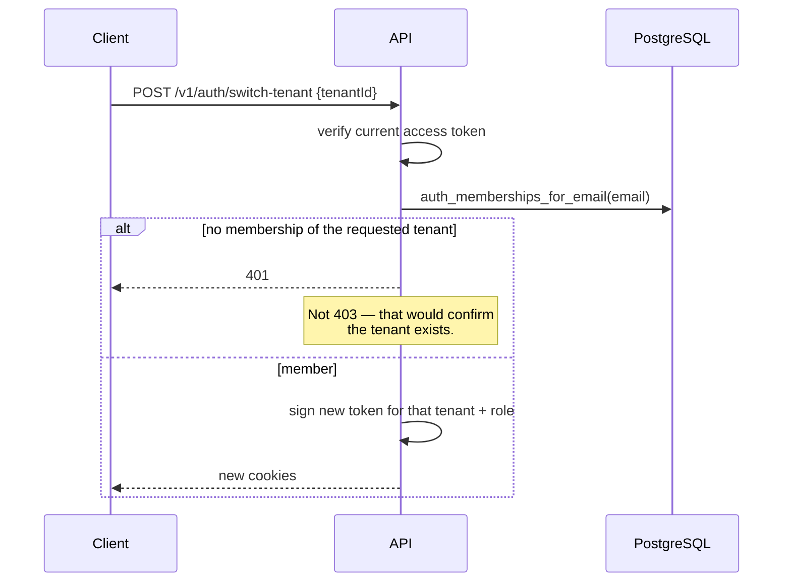

# Authentication and tenant scoping

The question this design answers: **how does a request prove which tenant it may touch?**

The answer is that tenant identity is a signed claim, resolved once at login from a
database lookup on a provider-verified email, and never accepted from the client
afterwards.

---

## Login — authorization code with PKCE

### Why each check is there

| Step | Attack it closes |
|---|---|
| `state` stored server-side, retrieved with `GETDEL` | CSRF on the callback, and replay of a captured callback URL |
| PKCE `code_verifier` never leaves the server | An intercepted authorization code is useless without it |
| ID token signature verified against the provider's JWKS | A forged token from anyone who knows the format |
| `iss` and `aud` checked | A valid token issued for a *different* application |
| `nonce` matched to this specific flow | Replay of a genuine ID token from another session |
| `email_verified` required | Anyone who can register at the provider claiming someone else's address |
| Membership read **from the database** | The client asserting which tenant it belongs to |

That last row is the one that matters most. A client can ask to log in as anyone; it
cannot make the database agree.

### Why the login lookup needs an escape hatch

`memberships` is RLS-protected — correctly, since otherwise any tenant could enumerate
another's users. But at login there is no tenant context yet: establishing which tenants
the identity may act in is precisely what login is *for*.

That is resolved by exactly one `SECURITY DEFINER` function,
[`auth_memberships_for_email()`](../apps/api/src/db/migrations/0003_auth_lookup.sql). It
answers one question, for one email, read-only, with a pinned `search_path` and `EXECUTE`
granted only to `app_user`. It is the entire RLS escape hatch in the system.

---

## Every subsequent request

Two transports are accepted, header first: an explicit credential always beats an ambient
one, so a stale cookie cannot silently override a token the caller deliberately supplied.

`algorithms: ['RS256']` is pinned during verification. Without it, the `alg: none` and
RS256→HS256 confusion attacks apply — the latter being where an attacker re-signs a token
using the *public* key as an HMAC secret.

**There is no code path in this application that reads a tenant from a header, a query
parameter or a body field.** `X-Tenant-Id` is a common convenience in multi-tenant APIs
and a straightforward account-takeover primitive wherever anything trusts it. There is a
test asserting it is ignored.

---

## Tokens

| | Access token | Refresh token |
|---|---|---|
| Format | JWT, RS256 | Opaque, 32 random bytes |
| Lifetime | 15 minutes | 14 days |
| Carries | `sub`, `tenantId`, `role`, `email`, `jti` | nothing — it is a lookup key |
| Storage | httpOnly cookie; also returned for API clients | httpOnly cookie |
| Revocable | No (short life instead) | Yes, individually and by family |
| Server state | None | SHA-256 hash in Redis |

**Asymmetric, not HS256.** The public half is published at `/.well-known/jwks.json`, so
other services — or a gateway, or a mesh — can verify tokens without being handed the
ability to mint them.

**The refresh token is opaque because there is nothing to gain from a self-describing
one.** It has to be checked against server state on every use anyway, since revocation is
the entire point. Only its SHA-256 is stored, so a dump of Redis yields no usable
credentials — the same reasoning as password hashing.

---

## Refresh rotation and reuse detection

**Why a Lua script rather than GET-then-SET.** Two concurrent refreshes with the same
token happen routinely — a browser with several tabs open. Read-then-write would let both
succeed and produce two live tokens where there should be one, or under the opposite
interleaving treat both as reuse and log a legitimate user out. Atomicity makes exactly
one of them the winner.

**Why revoke the whole family.** When a rotated token is presented again there is no way
to tell a client replay from a stolen copy. Revoking the family logs both parties out and
forces a fresh login, which is inconvenient for the legitimate user and fatal for the
attacker. That asymmetry is the right trade.

The event increments `saas_api_auth_events_total{event="refresh",outcome="reuse_detected"}`
and fires `RefreshTokenReuseDetected`.

---

## Tenant switching

A user may belong to several tenants — the seeded `dave@globex.test` belongs to two. They
hold **one token per tenant** and switch explicitly.

The database is re-queried every time. A token proves membership of tenant A when it was
issued; it says nothing about tenant B, and — just as importantly — it does not prove the
membership still exists. Access revoked five minutes ago must not be switchable back into.

There is deliberately **no server-side "current tenant" per session.** That would make the
effective tenant depend on request ordering under concurrency, which is a race condition
with a data-breach failure mode.

---

## Roles

Per-tenant, never global. `owner > admin > member`.

| Action | Minimum |
|---|---|
| Read projects, tasks, comments | `member` |
| Create and update tasks, comment | `member` |
| Create, update, archive projects | `admin` |
| Invite members, delete tasks | `admin` |
| Delete projects, change roles, remove members | `owner` |

Because role and tenant travel together in one signed token, authorisation never has to
ask "which tenant is this role for" — and there is no way to pair `owner` with a tenant
the user does not own. Owning tenant A confers nothing in tenant B.

Role checks are applied in **both** the REST preHandlers and the GraphQL resolvers. REST
middleware does not run for GraphQL, and that asymmetry is a classic way for a GraphQL
endpoint to end up quietly more permissive than the REST API beside it.

---

## The development identity provider

`apps/dev-idp` implements discovery, JWKS, authorization code with PKCE (S256), single-use
codes and constant-time client-secret comparison. The API performs a genuine exchange
against it and genuinely verifies the resulting ID token.

It exists because the brief wants OAuth2 *and* wants the whole thing to run from one
command on a clean machine, and those pull in opposite directions — every off-the-shelf
provider is either a heavyweight container that dominates the demo or an external account
the reader has to create. Stubbing auth in development would mean the OAuth2 path is never
executed until it reaches production.

**It authenticates nobody** — you pick a demo user from a list — and it is not deployed
anywhere. Pointing `OIDC_ISSUER`, `OIDC_CLIENT_ID`, `OIDC_CLIENT_SECRET` and
`OIDC_REDIRECT_URI` at Auth0, Google or Keycloak requires no code change, which is the
property that makes the shortcut acceptable.

---

## Limitations

- **Access tokens cannot be revoked before they expire.** Fifteen minutes is the exposure
  window. A denylist keyed on `jti` in Redis would close it at the cost of a lookup on
  every request; the short lifetime was judged a better trade.
- **`/v1/auth/session` re-checks membership, but ordinary requests do not.** A user whose
  membership is revoked keeps working access for up to 15 minutes.
- **No MFA.** Delegated to the identity provider, which is where it belongs — but it does
  mean this application enforces nothing about authentication strength.
- **No account lockout or credential stuffing protection.** Also the provider's job. Rate
  limiting at the edge is per-tenant and does not help an unauthenticated login flood.
- **Rotated credentials need a pod restart.** External Secrets refreshes the Kubernetes
  Secret, but config is read at boot.
