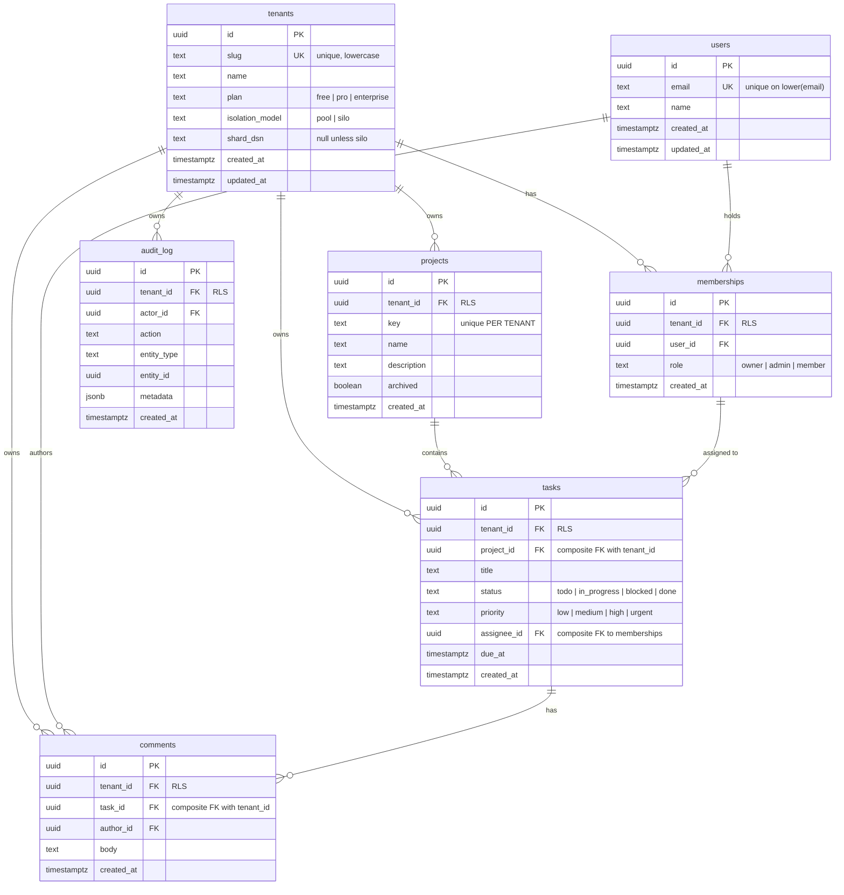

# Data model

This is a Mermaid diagram in Markdown rather than an `erd.png`, on purpose: it renders
natively on GitHub, it diffs in review, and it keeps a binary out of the Git history. If
a raster image is genuinely needed,
`docs/render-erd.sh` produces one from this source.

---

## Entity relationships



---

## The two conventions that do the work

### 1. `tenant_id` on every tenant-owned row, plus `UNIQUE (tenant_id, id)`

The unique constraint alongside the primary key looks redundant — `id` is already unique.
It exists so that child tables can declare a **composite** foreign key that includes
`tenant_id`.

### 2. Children reference parents as `(tenant_id, parent_id)`

```sql
CONSTRAINT tasks_project_fk FOREIGN KEY (tenant_id, project_id)
    REFERENCES projects (tenant_id, id) ON DELETE CASCADE
```

A task in tenant A pointing at a project in tenant B is therefore not merely *denied* —
it is **unrepresentable**. There is no application bug that can produce that row.

This matters because it holds independently of RLS. Foreign key checks run with the table
owner's privileges and deliberately bypass row security, so this is a genuinely separate
layer rather than the same check counted twice. If every policy in migration `0002` were
dropped tomorrow, cross-tenant *references* would still be impossible.

It also closes an information leak. Inserting a task with a foreign `project_id` fails on
the FK — but because the constraint includes `tenant_id`, the failure is identical whether
that project exists in another tenant or does not exist at all. Without the composite key,
the error message would be an existence oracle.

The same pattern applies to `comments → tasks`, and to `tasks.assignee_id →
memberships (tenant_id, user_id)` — so a task cannot be assigned to someone who is not a
member of that tenant. Because `assignee_id` is nullable and the default `MATCH SIMPLE`
semantics skip the check when any column is NULL, unassigned tasks are unaffected.

---

## What is not tenant-scoped, and why

| Table | RLS? | Reason |
|---|---|---|
| `tenants` | No | It is the table that *defines* the boundary. Read by primary key with an id from a verified token claim. |
| `users` | No | A user is a global identity — one email, one row — who may work for several customers. Tenant scoping lives on `memberships`. |
| `schema_migrations` | No | Migration bookkeeping, owned by the migrator. `app_user` has no grant on it at all. |

`memberships` is the security-critical join and **is** RLS-protected, so tenant A cannot
enumerate who belongs to tenant B — which would otherwise be a cross-customer user
enumeration oracle.

The one sanctioned exception is `auth_memberships_for_email()`, a `SECURITY DEFINER`
function that answers exactly one question for exactly one verified email address,
read-only, with a pinned `search_path`. It exists because login must determine which
tenants an identity may act in *before* any tenant context exists. The full argument is in
[migration 0003](../apps/api/src/db/migrations/0003_auth_lookup.sql).

---

## Indexes

Every index leads with `tenant_id`, because every query is filtered by it — both by the
service layer's explicit predicate and by the RLS policy. A leading `tenant_id` keeps
those plans index-only.

| Index | Columns | Serves |
|---|---|---|
| `projects_tenant_idx` | `(tenant_id, archived, created_at DESC)` | Project list |
| `projects_key_unique` | `(tenant_id, key)` | Per-tenant key uniqueness |
| `tasks_tenant_project_idx` | `(tenant_id, project_id, created_at DESC)` | Tasks in a project, keyset paginated |
| `tasks_tenant_status_idx` | `(tenant_id, status)` | Status filter |
| `tasks_tenant_assignee_idx` | `(tenant_id, assignee_id)` partial | "My tasks" — partial, so unassigned rows are not indexed |
| `comments_tenant_task_idx` | `(tenant_id, task_id, created_at)` | Comment thread |
| `audit_log_tenant_idx` | `(tenant_id, created_at DESC)` | Audit trail |
| `users_email_lower_key` | `lower(email)` | Case-insensitive login, without the citext extension |

---

## Constraints beyond foreign keys

- `tenants.slug` matches `^[a-z][a-z0-9-]{1,38}[a-z0-9]$` — usable in a URL or subdomain.
- `tenants` with `isolation_model = 'silo'` must have a non-null `shard_dsn`. A silo
  tenant without a DSN would silently fall back to the shared pool.
- `projects.key` matches `^[A-Z][A-Z0-9]{1,9}$`, unique **per tenant**. Two customers may
  both want `OPS`, and the seed data deliberately gives them both one.
- `status` and `priority` are `CHECK` constraints rather than enum types. Enums need
  `ALTER TYPE` to extend and cannot drop a value; a `CHECK` is a one-line migration.
- `audit_log` has no `UPDATE` or `DELETE` grant for `app_user`. An application that can
  rewrite its own audit trail does not have one.

---

## Regenerating this

The schema is the source of truth. To confirm this document still matches it:

```bash
docker compose up -d postgres
npm run migrate
docker compose exec postgres pg_dump -U postgres -d saas --schema-only
```
